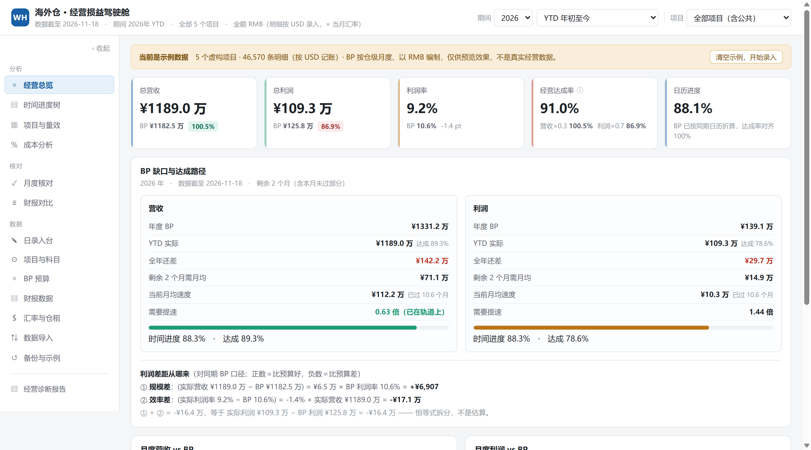

# 海外仓经营损益驾驶舱

单文件、零依赖的仓储经营损益分析与诊断工具。双击 HTML 就能用，数据存在浏览器本地（IndexedDB），不上传任何服务器。

## 为什么不用通用损益表

通用损益表告诉你「这个月赚了多少」，但不会告诉你「为什么亏、接下来该动哪里」。在仓储这个行业，直接套用通用报表会得出错误结论。

原因在成本结构：仓储的固定成本（仓租、自有员工、折旧）占大头，**毛利率和边际贡献率差得很远**。而通用的模板只看毛利率，于是：

- 毛利率 21%，看起来「略低但过得去」
- 按成本性态拆开，边际贡献率也只有 21%，扣完固定成本实际在亏
- 更关键的是：占营收大头的那个客户，边际贡献率是负的——越做越亏

这三件事，一张毛利率表永远看不到。

## 它回答什么问题

| 问题 | 靠什么回答 |
|---|---|
| 多接一单是赚还是亏 | 变动成本 ÷ 单量，对比单均收入 |
| 这个月亏这么多，缺口有多大 | 保本营收 = 固定成本 ÷ 边际贡献率 |
| 哪个客户该砍、砍了损失多少 | 项目级边际贡献 + 自身利润（剔回公摊） |
| 空置到底白付多少钱 | 当月整月租金 − 各项目已承担场地费 |
| 人是多了还是少了 | 单量 vs 人力成本双轴趋势 + 人力 ÷ 毛益 |
| 业务结构健不健康 | ToB（重储存，看元/m³/月）vs ToC（重操作，看元/单）分标尺 |
| 满仓能不能保本 | 满仓毛益 vs 固定成本的缺口检验 |

## 页面结构

- **经营总览** — 5 个 KPI（营收 / 利润 / 利润率 / 经营达成 / 日历进度）、BP 缺口与达成路径、利润差额拆解（规模差 + 效率差）
- **时间进度树** — 12 个月逐月展开成周；当月 = 实际 ÷ 已录天数 × 当月天数 + 手工增量；未来月 = 近 2 月均值
- **项目与量效** — 单量 vs 人力成本趋势、各项目横向对比 + 利润阶梯（点行展开逐月）
- **成本分析** — 1 元营收拆解、成本率趋势（含比率 1 的盈亏平衡线）
- **核对** — 月度核对、财报对比
- **数据** — 日录入台（科目 × 日期矩阵）、项目与科目、BP 预算、汇率与仓租、导入导出
- **经营诊断报告** — 问题分级 + 影响金额 + 负责人 + 目标 + 算法说明，可导出 PDF

## 快速开始

1. 下载 `warehouse-pnl-cockpit.html`
2. 双击用浏览器打开（Chrome / Edge 均可）
3. 点「备份与示例 → 载入示例数据」——会生成一个 5 个虚构客户、约 4.6 万条明细的演示仓，所有功能都能跑通
4. 看完点「清空示例，开始录入」，换成自己的数

导出的 JSON 备份可以在换机时导入；数据本身不会离开你的电脑。

## 口径说明

这几条是工具的骨架，也是它和通用报表的分歧所在：

1. **成本性态三分**：固定（仓租、自有直接人力、折旧）/ 变动（外包人力、耗材、装卸、赔付）/ 半变动（办公耗材、差旅）
2. **边际贡献 = 营收 − 变动成本**，cmr = 边际贡献 ÷ 营收
3. **空置仓租** = 当月整月租金 − 各项目已承担场地费，差额记入「仓级公共」，不分摊到业务项目
4. **项目自身利润** = 报表利润 + 公摊成本（科目名含「分摊」的固定成本）——报表利润受分摊规则影响，换个摊法结论就变，判断该不该砍要用自身口径
5. **达成率** = 1 + (实际 − BP) ÷ |BP|，分母取绝对值，否则亏损预算下「多亏」会被算成「超额完成」

**关于阈值**：工具里没有行业标准线。用到的只有两类——恒等式（人力 ÷ 毛益 = 100%，即人力吃光全部边际贡献）和同类项目中位数。凡是**经验线**，界面上都明确标了「非行业标准」。

## 边界

- 单仓工具，不做多仓汇总
- 科目口径按实际管过的一个海外仓设计，不一定适合所有业态，可在「项目与科目」里逐项修改（支持新增子科目、改名称和单位）
- 只处理金额与业务量，不含库存明细、不含 WMS 作业
- 单人使用；多人协作需要自己接后端

## 技术实现

- 单个 HTML 文件，手写 SVG 图表，无任何第三方依赖
- 数据存 IndexedDB，不可用时降级到 localStorage
- 汇率：明细按 USD 录入、展示折 RMB；BP 用 RMB 编制不折算
- 内置 1,033 项回归断言（Node 环境跑，不进浏览器）

## License

MIT
